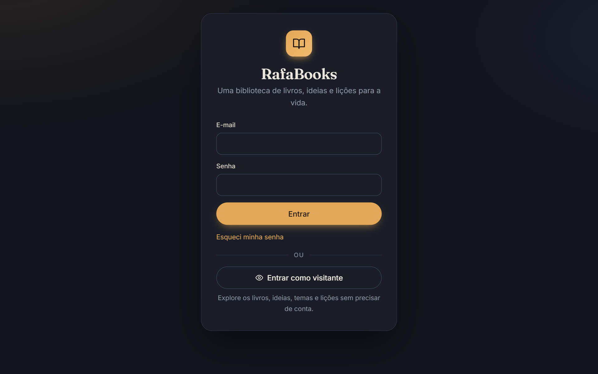
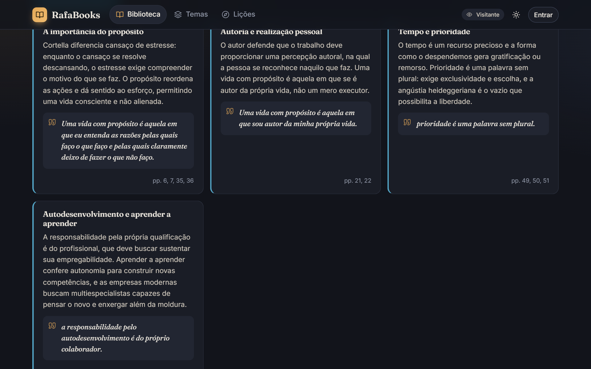
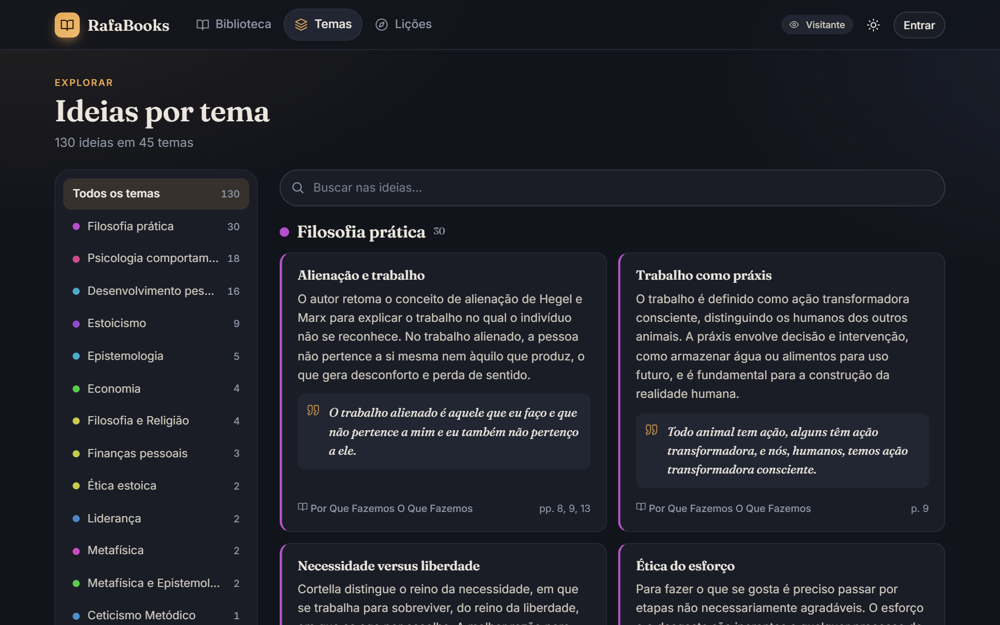
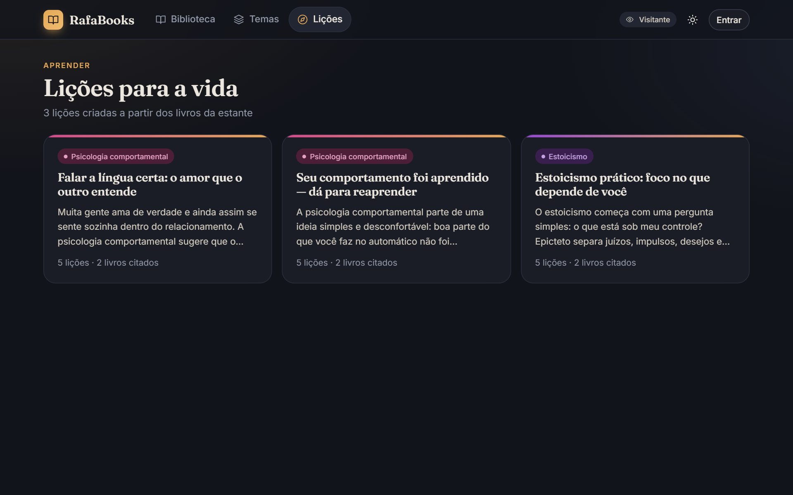
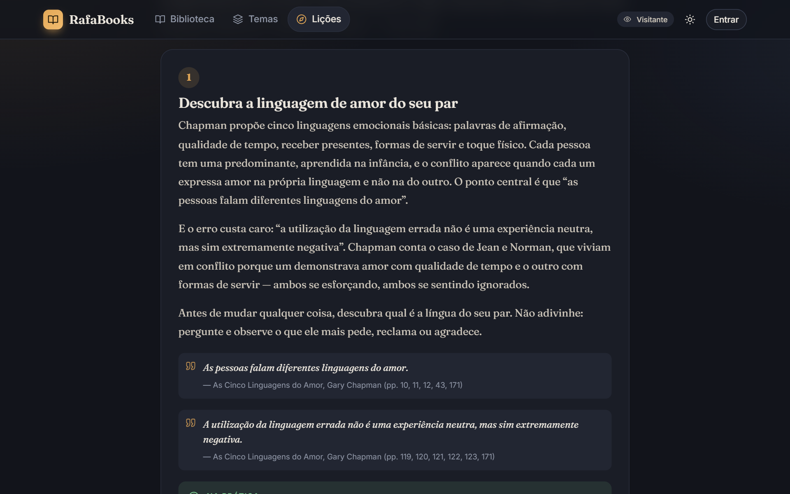
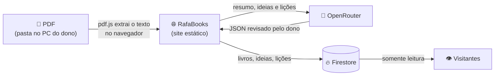

<p align="center">
  
</p>

<h1 align="center">📚 RafaBooks</h1>

<p align="center">
  <strong>Uma biblioteca de livros transformada em ideias, temas e lições para a vida.</strong><br>
  Resumos, ideias com citações literais, exploração por tema e lições práticas — tudo num só lugar.
</p>

<p align="center">
  <a href="https://rafabook.web.app"></a>
</p>

<p align="center">
  
  
  
  
</p>

---

## 👁️ Entre como visitante — sem criar conta

> [!TIP]
> Abra **[rafabook.web.app](https://rafabook.web.app)** e clique em **“Entrar como visitante”**.
> Você pode ler todos os livros cadastrados, seus **resumos**, as **ideias** com passagens citadas,
> navegar **por tema** e ler as **lições para a vida** — no computador ou no celular.

<p align="center">
  
</p>

| Como visitante você pode | Reservado ao dono da biblioteca |
|---|---|
| ✅ Ler resumos e ideias de todos os livros | 🔒 Cadastrar e editar livros |
| ✅ Explorar ideias agrupadas por tema | 🔒 Gerar resumos e lições com IA |
| ✅ Ler as lições, com exercícios e reflexões | 🔒 Abrir os PDFs (ficam no computador do dono) |
| ✅ Alternar entre tema claro e escuro | 🔒 Compartilhar e excluir conteúdo |

---

## ✨ Funcionalidades

### 📖 Estante com resumos e ideias

Cada livro tem capa, resumo em formato de leitura e suas principais ideias, organizadas por tema.
As ideias trazem **citações literais** do livro, conferidas automaticamente no texto do PDF — a IA não consegue inventar trechos.

<p align="center">
  
  
</p>

### 🧭 Ideias por tema

Todas as ideias de todos os livros, agrupadas por tema — Estoicismo, Psicologia comportamental, Finanças pessoais…
É o jeito mais rápido de comparar o que autores diferentes dizem sobre o mesmo assunto.

<p align="center">
  
</p>

### 🌱 Lições para a vida

A partir das ideias salvas, o RafaBooks escreve **lições práticas** sobre um tema: cada passo explica a ideia,
cita as passagens dos livros, propõe um exercício **“Na prática”** e uma pergunta **“Para refletir”**.
Uma lição pode ser compartilhada por link (inclusive pelo WhatsApp) com quem não tem conta.

<p align="center">
  
  
</p>
<p align="center">
  
</p>

### 📱 No celular e em tema claro

Layout responsivo com barra de navegação inferior no celular, e tema claro “papel” para leitura de dia.

<p align="center">
  
  
  
</p>

---

## 🛠️ Como funciona



- **Sem backend**: HTML, CSS e JavaScript puro, hospedado no Firebase Hosting.
- **PDFs fora da nuvem**: ficam numa pasta do computador do dono (File System Access API); só o texto necessário vai para a IA.
- **Livros longos**: o texto é dividido em partes, cada parte gera ideias com páginas, e uma etapa final consolida tudo.
- **Citações verificadas**: todo trecho proposto pela IA é procurado no texto real do PDF; se não existir, é descartado.
- **Lições baratas**: são escritas a partir das ideias já salvas, sem reler os PDFs — custam frações de centavo.
- **Segurança**: regras do Firestore permitem a visitantes apenas leitura; a chave do OpenRouter fica só no navegador do dono.

---

## 👩‍💻 Para desenvolvedores

<details>
<summary><strong>Estrutura do projeto</strong></summary>

```
public/
  index.html
  css/styles.css
  js/
    app.js                      roteador (hash), login e modo visitante
    config/app-config.js        limites de IA e do app
    config/firebase-config.js   config do Firebase (local, fora do Git; modelo: firebase-config.example.js)
    services/
      index.js                  liga os provedores concretos (troque aqui armazenamento/IA)
      firebase.js, auth.js
      books-repo.js             Firestore: users/{uid}/books/{bookId}
      lessons-repo.js           Firestore: users/{uid}/lessons/{lessonId}
      library-repo.js           Firestore: site/library (biblioteca pública)
      share-repo.js             Firestore: shared/{shareId} (lições compartilhadas)
      storage/folder-storage.js pasta local: copiar, abrir, listar, apagar PDFs
      pdf/pdf-text.js           extração de texto e capa com pdf.js
      ai/openrouter-client.js   chamadas ao OpenRouter (com retry)
      ai/book-analyzer.js       resumo + ideias por partes (map-reduce) e citações verificadas
      ai/lesson-generator.js    lições por tema a partir das ideias salvas
      ai/api-key-store.js       chave no localStorage
    ui/
      dom.js, icons.js, theme.js, store.js
      views/                    library, book-detail, book-form, themes, lessons, shared-lesson, settings
docs/screenshots/               imagens deste README
firestore.rules                 dono escreve; visitantes só leem a biblioteca pública
firebase.json
```

</details>

<details>
<summary><strong>Configuração do Firebase (uma vez)</strong></summary>

1. Em <https://console.firebase.google.com>, crie um projeto.
2. **Authentication** → *Método de login* → ative **E-mail/senha**. Crie a sua conta em
   *Authentication → Usuários → Adicionar usuário* (o app não tem tela de cadastro) e, em
   *Configurações → Ações do usuário*, desmarque **Ativar criação (inscrição)**.
3. **Firestore Database** → *Criar banco de dados* em modo de produção.
4. **Configurações do projeto** → *Seus apps* → app **Web**. Copie
   `public/js/config/firebase-config.example.js` para `public/js/config/firebase-config.js` e preencha
   `apiKey`, `authDomain`, `projectId` e `appId`. Esse arquivo fica fora do Git.
5. Em `.firebaserc` e `firebase.json` (`"site"`), use o seu projeto e site do Hosting, e confira os
   **Domínios autorizados** em *Authentication → Configurações*.

> A config web do Firebase não é segredo — a segurança vem das `firestore.rules`.

</details>

<details>
<summary><strong>Rodar localmente e publicar</strong></summary>

Os módulos ES precisam ser servidos por HTTP:

```bash
firebase serve --only hosting
```

Abra <http://localhost:5000>. Para publicar o site e as regras:

```bash
firebase deploy --only hosting,firestore:rules
```

</details>

<details>
<summary><strong>Pasta dos PDFs</strong></summary>

- Funciona no **Chrome e no Edge para desktop**. No **Brave**, ative `brave://flags/#file-system-access-api` → *Enabled* → *Relaunch*.
  Em outros navegadores e no celular, resumos, ideias e lições funcionam, mas os PDFs não abrem.
- O navegador lembra a pasta, mas costuma pedir confirmação de acesso uma vez por sessão.
- Use uma pasta sincronizada (OneDrive, Google Drive para computador, Dropbox) para ter backup.
- Os livros guardam só o **nome do arquivo**; se renomear ou mover o PDF, basta editar o livro e vincular de novo.
- Excluir um livro **não** apaga o PDF, a menos que você marque essa opção na confirmação.

</details>

<details>
<summary><strong>IA: análise, citações e lições</strong></summary>

**Análise de livros**
1. O PDF é lido no navegador com pdf.js; cada página recebe um marcador `[p. N]`.
2. Livros curtos (até ~60 mil caracteres) usam uma chamada. Livros longos são divididos em blocos (map-reduce).
3. Os temas já existentes são enviados ao modelo para manter a classificação consistente.
4. O resultado preenche o formulário; **nada é salvo até o dono revisar**.

Modelo padrão: `deepseek/deepseek-v4-flash` (trocável em *Ajustes*). Limites em `public/js/config/app-config.js`.
PDFs escaneados (só imagem) não têm texto extraível; use o modo manual.

**Citações literais** — o modelo propõe um trecho e o app confere se ele existe no texto do PDF (ignorando acentos,
pontuação e quebras de linha). Para livros antigos, *Editar → Buscar citações* procura trechos só nas páginas de cada ideia.

**Lições** — escritas a partir das ideias salvas. O modelo só aponta quais ideias sustentam cada passo;
as citações exibidas vêm sempre dos dados salvos, nunca do texto gerado.

**Chave do OpenRouter** — fica apenas no `localStorage` do navegador do dono (nunca no código, no Git,
no Firestore ou no backup) e só é enviada ao `openrouter.ai`. Recomenda-se uma chave exclusiva com limite de crédito.

</details>

<details>
<summary><strong>Compartilhamento e visitantes</strong></summary>

**Lição compartilhada** — *Compartilhar → Criar link público* grava uma cópia em `shared/{código}` (código aleatório
de 128 bits, coleção não listável) e gera `https://rafabook.web.app/s/<código>`. Editar a lição atualiza o link;
*Parar de compartilhar* apaga a cópia.

**Biblioteca pública** — *Ajustes → Acesso de visitantes → Tornar pública* cria `site/library` com o uid do dono.
Enquanto ele existir, as regras liberam **somente leitura** de `users/{uid}/books` e `/lessons`, e a tela de login
mostra *Entrar como visitante*. *Tornar privada* apaga o documento e o acesso some na hora.

</details>

<details>
<summary><strong>Modelo de dados (Firestore)</strong></summary>

`users/{uid}/books/{bookId}`

```js
{
  title, author, year,
  summary: "texto",
  ideas: [{ id, title, description, theme, pages: [12, 40], quote }],
  file: { fileId, name, size, mimeType, provider }, // fileId = nome do PDF na pasta local
  cover: "data:image/jpeg;base64,...",               // miniatura da 1ª página (~30 KB)
  analysis: { mode: "manual" | "ai", model?, generatedAt? },
  createdAt, updatedAt
}
```

`users/{uid}/lessons/{lessonId}`

```js
{
  title, intro, closing, themes: ["Estoicismo"], focus, shareId?,
  steps: [{ id, title, text, practice, question,
            citations: [{ bookId, bookTitle, author, ideaId, ideaTitle, quote, pages }] }],
  analysis: { mode: "manual" | "ai", model?, generatedAt? },
  createdAt, updatedAt
}
```

`site/library` → `{ ownerUid }` · `shared/{shareId}` → cópia pública de uma lição + `ownerUid`

</details>

---

<p align="center">
  Feito com 📚 e ☕ por <a href="https://github.com/RafLopes">Rafael Lopes</a>
</p>
